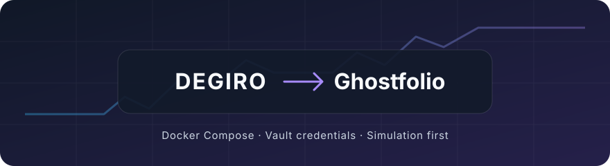

<div align="center">



# DEGIRO → Ghostfolio

**Your broker activity. Your portfolio. Your infrastructure.**

Synchronize DEGIRO with your existing [Ghostfolio](https://ghostfol.io) account, using Docker Compose and credentials from Bitwarden or Vaultwarden.

[](https://github.com/flowcool/ghostfolio-degiro-sync/actions/workflows/checks.yml)
[](https://github.com/flowcool/ghostfolio-degiro-sync/releases)
[](compose.yaml)
[](LICENSE)

[**Get started**](#get-started) · [**Configuration**](#1-prepare-the-configuration) · [**Troubleshooting**](#troubleshooting) · [**Contributing**](CONTRIBUTING.md) · [**Report an issue**](https://github.com/flowcool/ghostfolio-degiro-sync/issues)

</div>

## Why use it?

- 📈 **Keep activities together** — supported executions, paid dividends, fees and current EUR cash in Ghostfolio.
- 🔐 **Fetch credentials from your vault** — a fresh Bitwarden or Vaultwarden login on every broker execution.
- 🧪 **Review before importing** — simulate and save a private proposal with zero financial writes.
- 🐳 **Run with Docker Compose** — connector, vault CLI and scheduler included; native amd64 and arm64 images.
- 🕒 **Choose your rhythm** — run manually or schedule recurring synchronization, with optional Apprise failure alerts.
- 🛡️ **Stop on uncertainty** — unknown events, ambiguous matches and unresolved imports block dispatch.

> [!IMPORTANT]
> **Start with a simulation.** `DRY_RUN=1` authenticates and reads, proposes activities and cash, and sends no financial writes. Supported synchronization uses a rolling 90-day window; it does not certify your earlier history or cost basis.

## Get started

| Step | What you will do |
| --- | --- |
| [1. Configure](#1-prepare-the-configuration) | Set up the vault, Ghostfolio connection, mapping and private storage |
| [2. Discover](#2-pull-the-image-and-discover-account-ids) | Pull the image and find your source and destination account IDs |
| [3. Simulate](#3-run-a-simulation) | Save and review the proposed activities and cash |
| [4. Schedule](#4-choose-manual-or-scheduled-operation) | Choose manual runs or a daily simulation before enabling writes |

### What you need

- Docker Engine with Docker Compose v2 and a Linux host supporting bind-mount permissions; native amd64 and arm64 images are tested in CI.
- An existing Ghostfolio account and its **Security Token**, plus the destination account ID. Ghostfolio itself is not installed by this project.
- A DEGIRO Login item in Bitwarden/Vaultwarden containing username, password and the **TOTP secret** in its authenticator field. A six-digit temporary code is not a secret seed.
- A personal Bitwarden API key, master password, item UUID and HTTPS vault URL. Use a dedicated vault account containing only the credentials needed by this service.
- An existing Docker network shared with Ghostfolio, and a verified ISIN-to-Yahoo-symbol mapping for your holdings.

DEGIRO is accessed through an unofficial private API. Supported cash descriptions and relationships are currently characterized for French statements, EUR cash and the contracts in [cash-rules.yaml](cash-rules.yaml). Unknown instruments, categories or ambiguous events stop synchronization. This is not a universal broker-history importer.

## 1. Prepare the configuration

```sh
git clone https://github.com/flowcool/ghostfolio-degiro-sync.git
cd ghostfolio-degiro-sync
cp .env.example .env
cp mapping.yaml.example mapping.yaml
mkdir -p state
chmod 600 .env mapping.yaml
sudo chown 10001:10001 mapping.yaml state
sudo chmod 700 state
```

Edit `.env` and `mapping.yaml`. Both are ignored by Git. Use single quotes around secrets in `.env` so `$` and `#` remain literal. Your own environment injection can supply the same variables instead. Docker daemon operators can access container environment values; restrict access to the host and its backups.

### Bitwarden / Vaultwarden

Create or select the DEGIRO **Login** item. Its `username`, `password` and authenticator/TOTP field must be populated. Supported TOTP is SHA1, six digits, a 30-second interval, with either a Base32 seed or an `otpauth://totp/...` URI. An HOTP counter, a temporary OTP or another algorithm is refused.

Obtain the personal API key from Bitwarden account settings, **Security → Keys → API key**. Copy the exact item UUID, not its display name. Supply:

| Variable | Required | Meaning |
| --- | --- | --- |
| `BW_SERVER` | Yes | `https://vault.bitwarden.com`, `https://vault.bitwarden.eu`, or your Vaultwarden HTTPS origin, without a trailing slash |
| `BW_CLIENTID` | Yes | Personal API-key client ID |
| `BW_CLIENTSECRET` | Yes | Personal API-key client secret |
| `BW_PASSWORD` | Yes | Vault master password; used to unlock the encrypted vault |
| `BW_ITEM_ID` | Yes | UUID of the DEGIRO Login item |

**Migrating from direct broker credentials?** Move the DEGIRO username, password and TOTP seed into the vault Login item, configure the `BW_*` values above, and remove `DEGIRO_USERNAME`, `DEGIRO_PASSWORD` and `DEGIRO_TOTP_SECRET` from the container environment. Direct credential variables are explicitly rejected when present (including empty values), even when vault credentials are configured. There is no direct-login fallback.

<details>
<summary>How vault sessions are isolated</summary>

Every broker execution creates private temporary CLI state, authenticates, unlocks, synchronizes the vault and reads this exact item, then logs out and removes the temporary state. Nothing is mounted from another application's vault session. A vault failure blocks broker login; no cached credential fallback is used. No vault credential or item content is printed.

</details>

### Ghostfolio and account settings

| Variable | Required | Meaning / default |
| --- | --- | --- |
| `GHOST_HOST` | Yes | Final Ghostfolio origin; default `http://ghostfolio:3333`. HTTPS origins and private/container HTTP are supported; paths, URL credentials, redirects, queries and fragments are refused |
| `GHOST_ACCESS_TOKEN` | Recommended | Ghostfolio **Security Token**, exchanged for a bearer once per execution; configure exactly one Ghostfolio credential |
| `GHOST_TOKEN` | Alternative | Legacy expiring bearer; leave unset when using `GHOST_ACCESS_TOKEN` |
| `GHOST_ACCOUNT_ID` | Yes | Destination account UUID; use the private account discovery below |
| `DEGIRO_ACCOUNT_ID` | Yes | Numeric DEGIRO source `intAccount`; see discovery below |
| `GHOST_NETWORK` | Yes | Existing Docker network that reaches Ghostfolio; inspect available names with `docker network ls` |

The hostname in `GHOST_HOST` must resolve from the importer container. For the default, the Ghostfolio service needs the `ghostfolio` alias on the selected network. Another existing service hostname or a private IP can be configured. The image does not provide an HTTP proxy, interactive login or custom TLS bypass.

### Mapping, storage and scheduling

| Variable | Default | Meaning |
| --- | --- | --- |
| `DEGIRO_MAPPING_PATH` | `./mapping.yaml` | Existing read-only mapping file; readable by UID 10001 |
| `DEGIRO_STATE_PATH` | `./state` | Persistent journal directory, writable by UID/GID 10001, mode 0700 |
| `DRY_RUN` | `1` | `1` simulates; `0` permits financial writes after you review and approve your setup |
| `CRON` | Empty | Empty runs once; five numeric cron fields enable the scheduler |
| `APPRISE_URLS` | Empty | Optional JSON list of notification URLs, e.g. `'["ntfy://notification-host/topic"]'` |
| `APPRISE_TIMEOUT` | `10` | Notification deadline in seconds, 1–30 |
| `DEGIRO_IMAGE` | `ghcr.io/flowcool/ghostfolio-degiro-sync:v0.2.2` | Published version or immutable `ghcr.io/flowcool/ghostfolio-degiro-sync@sha256:...` digest; amd64/arm64 |

The template sets `SYNC_MODE=rolling`, `LOOKBACK_DAYS=90`, `TZ=Europe/Zurich`, `/config/mapping.yaml` and `/state`. The broker date boundary is Europe/Zurich. The container runs as UID/GID 10001, with a read-only root filesystem and no Linux capabilities. Existing mounts are required; Compose refuses to create missing files silently.

The state directory must belong to the **running UID 10001**, with mode 0700; private lock and journal files use 0600. Keep the mapping readable by that UID (the setup above assigns ownership and mode 0600). On NAS hosts, also check bind-mount ACLs if access fails despite ordinary Unix permissions. Changing the container to root does not fix the required state ownership; keep the supplied `user` setting.

Example mapping; verify both Yahoo symbol and quote currency for **every** instrument:

```yaml
US0378331005:
  symbol: AAPL
  currency: USD
```

Mapping keys must be valid ISINs. Each entry must contain **exactly** `symbol` and `currency`, with a nonempty symbol and no surrounding whitespace. Supported quote currencies are **EUR, USD and JPY only**; an entry using GBP, CHF or another currency rejects the entire mapping. The same Yahoo symbol cannot have conflicting currencies. Current cash synchronization is limited to EUR.

## 2. Pull the image and discover account IDs

```sh
docker compose pull
```

The published image includes the pinned DEGIRO connector, Bitwarden CLI and scheduler. Docker selects amd64 or arm64 automatically. Version tags are published once; `latest` follows stable releases only. Prefer the explicit version above or a digest for controlled upgrades. Local builds are a contributor workflow.

If you do not know `DEGIRO_ACCOUNT_ID`, temporarily leave a nonempty placeholder in `.env` and capture a private read-only snapshot for a recent date interval:

```sh
docker compose run --rm degiro-sync --read-only \
  --from-date YYYY-MM-DD --to-date YYYY-MM-DD \
  --window-days 90 --output /state/account-discovery.json
```

Replace the dates. Read `source_account` in the resulting private JSON file and set `DEGIRO_ACCOUNT_ID` to that value. This procedure uses Bitwarden and DEGIRO only, does not contact Ghostfolio and refuses to overwrite a capture. Keep the snapshot private; it contains financial data. Restore a real account ID before running synchronization.

To discover Ghostfolio destination IDs, leave a nonempty temporary `GHOST_ACCOUNT_ID` placeholder and run:

```sh
docker compose run --rm degiro-sync --ghost-accounts --output /state/ghostfolio-accounts.json
```

Read the account ID/name/currency in the private output and set `GHOST_ACCOUNT_ID`. This command authenticates to Ghostfolio and performs one account-list GET; it never contacts DEGIRO and discards balances and extra response fields. Restore both real account IDs before synchronization.

### Command modes and date windows

Compose supplies the account placeholders and environment even for discovery; use nonempty placeholders where an ID is still unknown.

| Mode | Required arguments | Scope |
| --- | --- | --- |
| `--read-only` | `--from-date`, `--to-date`, `--output` | Broker capture; no Ghostfolio access or financial writes |
| `--ghost-accounts` | `--output` | Ghostfolio account discovery; no broker access |
| `--sync` | No additional arguments for the supplied rolling setup | Read and reconcile the configured account pair; financial writes controlled by `DRY_RUN` |

`--window-days` is **optional**, defaults to 90 and accepts an integer from 2 to 366. It controls broker query chunk size, not the overall synchronization lookback. Read-only dates are inclusive ISO dates (`YYYY-MM-DD`); the end must not precede the start. Every `--output` or `--plan-output` destination must be a **new path**; existing files are never overwritten.

The supplied Compose configuration explicitly selects `SYNC_MODE=rolling` and `LOOKBACK_DAYS=90`. Synchronization defaults to the 90 calendar days ending today in Europe/Zurich. An explicit `--to-date` must still be today, and `--from-date` must cover at least that window. An earlier start can cover an outage; see [recovery and stopping](#updates-recovery-and-stopping).

**A saved read-only capture is not a prerequisite for rolling synchronization.** Discovery helps obtain IDs; rolling mode reads and verifies fresh statements, holdings and account evidence on each run, including the first run with an empty state directory. DRY_RUN retains these integrity checks. The CLI requires one explicit command mode; the container entrypoint supplies `--sync` for normal runs. The adapter's default outside Compose is `full_history`, which cannot dispatch without verified complete history. The advanced `prospective` mode requires reviewed cutover evidence; neither is a shortcut around a failed rolling check. See [synchronization contracts](docs/synchronization.md).


## 3. Run a simulation

Keep `DRY_RUN=1` and `CRON` empty:

```sh
docker compose run --rm degiro-sync --sync --plan-output /state/first-plan.json
```

A successful run reports zero accepted imports and a verified rolling contract. Review `state/first-plan.json` against DEGIRO and your existing Ghostfolio entries. It contains the exact proposed activities and current cash, uses private mode 0600, and refuses overwrites. Choose a new filename for later reviews. Logs contain counts rather than the full activity payload.

Unknown source events, mismatched holdings, incomplete statements, changed canonical activities or unresolved write intents produce a nonzero exit code. Do not enable writes to bypass a failed simulation. The first window may propose missing operations from before installation. Missing older history must be reconciled separately; no opening BUY or invented cash flow is created.

## 4. Choose manual or scheduled operation

For manual operation, leave `CRON` empty and use the same `run --rm` command.

For daily **simulations** at 06:15 Europe/Zurich, use the guarded overlay:

```sh
docker compose -f compose.yaml -f compose.dry-run.yaml up -d
docker compose -f compose.yaml -f compose.dry-run.yaml logs --tail 100 -f
```

The overlay fixes `DRY_RUN=1` and the schedule. Scheduling does not execute an immediate run. To enable financial synchronization after review, stop the simulation service, set `DRY_RUN=0` and your quoted `CRON` in `.env`, then start the base alone:

```sh
docker compose -f compose.yaml -f compose.dry-run.yaml stop degiro-sync
# Edit .env: DRY_RUN=0 and CRON='15 6 * * *'.
docker compose up -d --force-recreate degiro-sync
```

Before enabling writes, back up Ghostfolio and verify your restoration procedure. The adapter imports supported BUY/SELL, paid dividends with linked withholding, characterized standalone fees and cash-yield activities, then updates verified current EUR cash. Unknown or ambiguous relevant data blocks the account. Existing entries are not automatically corrected or deleted.

Apprise sends one sanitized alert for a failed scheduled run, including DRY_RUN, and for failed live synchronization. Successful runs, manual simulations and read-only captures are silent. The notification library is included; a separate Apprise server is optional and destinations still need configuration. No delivery retry is performed.

## Updates, recovery and stopping

```sh
# Record this value privately before upgrading; it is the rollback image.
docker image inspect "$(docker compose config --images)" --format '{{index .RepoDigests 0}}'
docker compose stop degiro-sync
# Set DEGIRO_IMAGE in .env to the reviewed new version or digest.
docker compose pull
docker compose up -d --force-recreate degiro-sync
```

To roll back, stop the scheduler, set `DEGIRO_IMAGE` to the saved previous
`ghcr.io/flowcool/ghostfolio-degiro-sync@sha256:...` value, then pull and recreate
with the same commands. Keep the existing mounts and journals; do not reinitialize
state or replay uncertain imports. Confirm the pulled digest before starting.

Preserve `.env`, `mapping.yaml` and the entire state directory. Credentials are fetched from the vault on the next execution; changing the vault API key or master password in `.env` requires recreating the container. `docker compose restart` retains its old environment. Never run two importers against the same source/destination journal simultaneously.

For an outage beyond saved successful coverage, use an explicit earlier start date while keeping the end date today:

```sh
docker compose run --rm -e CRON= degiro-sync --sync --from-date YYYY-MM-DD
```

Stop the existing scheduler first and review the catch-up in DRY_RUN. Interrupted imports are cleared only after exact positive readback; partial or uncertain results remain blocked. See [recovery](docs/recovery.md). Do not delete the journal to force a retry. Image rollback does not undo imported activities or cash changes.

## Troubleshooting

Failed commands append a stable diagnostic pair, for example `stage=config reason=mapping` or `stage=transactions reason=failed`. Both tokens come from a fixed allowlist; exceptions, credentials, keys, URLs, paths, account IDs and response values are never included in the diagnostic. Malformed CLI arguments return exit code 2 with a fixed message; operational failures return 1. Use `--help` for command syntax.

| Diagnostic | Where to look |
| --- | --- |
| `stage=config` | The named local check: `arguments`, `mode`, `date_range`, `window_days`, `lookback_days`, `report_locale`, `mapping`, `state_dir`, `account`, `sync_mode`, `ghostfolio_credentials`, `direct_credentials` or `broker_credentials` |
| `stage=vault` | Vault `configuration`, `temporary_state`, `server`, `login`, `unlock`, `sync`, `item` or `logout`; `item` includes Login/TOTP validation |
| `stage=login` | DEGIRO login; a known fixed auth reason may distinguish timeout, TLS, HTTP refusal or required interactive authentication |
| `stage=client_discovery`, `transactions`, `account_overview`, `products`, `account_info`, `account_update`, `account_report`, `order_history`, `cutover_destination`, `logout` | The named broker read/cleanup step; `reason=failed` does not echo provider data |
| `stage=ghostfolio` | Token `authentication`, `transport`, `account_read` or `activities_read` |
| `stage=output` | Private file `destination` validation or `write` |
| `stage=broker` | General `read` failure or post-read `api_format` validation |
| `stage=sync` | `reconciliation` of account evidence, or an unclassified `failed` run |

The earliest classified failure is preserved across outer boundaries. A token identifies the failed check, not a root cause or proof that all preceding authentication succeeded. Generic summaries remain private by design; older images may not include diagnostic tokens. Check these local prerequisites first:

| Symptom / check | What to verify |
| --- | --- |
| Vault or broker login fails | All required `BW_*` values; exact Login item UUID; username, password and supported TOTP seed; no direct `DEGIRO_*` credential variables |
| Read-only capture fails | Both ISO dates, end on or after start, a new writable `--output` path, and `--window-days` between 2 and 366 |
| Mapping is rejected | Valid ISINs, exactly `symbol`/`currency`, EUR/USD/JPY only, no whitespace or currency conflicts; UID 10001 can read the mount |
| State access fails | Existing directory owned by UID 10001, mode 0700, accessible bind-mount ACLs; preserve existing journals |
| Rolling synchronization fails | Explicit rolling mode, `LOOKBACK_DAYS=90`, end date today in Europe/Zurich, sufficient start date and no saved coverage gap; then review account/mapping evidence |
| Ghostfolio access fails | Exactly one credential, final reachable origin without a trailing slash, correct account ID and Docker network; recreate after environment changes |

If these checks do not resolve the failure, keep DRY_RUN enabled and [report an issue](https://github.com/flowcool/ghostfolio-degiro-sync/issues) with the image version, command options, exit code and sanitized log message. Keep credentials, captures and rendered `docker compose config` private. Do not enable raw connector logging or publish tracebacks containing runtime values. See [read-only captures](docs/read-only.md), [authentication](docs/ghostfolio-auth.md) and [recovery](docs/recovery.md) for the relevant contract.

## Compatibility, upstreams and development

All upstreams and their monitoring are listed in [docs/upstreams.md](docs/upstreams.md). Release notices request a review; they do not prove compatibility or automatically deploy anything. DEGIRO endpoint changes can occur without a connector release and are detected through explicit response validation and regression tests.

The broker-independent core is a byte-preserved projection of the reviewed IBKR source, tracked in [CORE_PROVENANCE.md](CORE_PROVENANCE.md). [CONTRIBUTING.md](CONTRIBUTING.md) covers development and synthetic testing. Host Python execution is not a supported user deployment.
