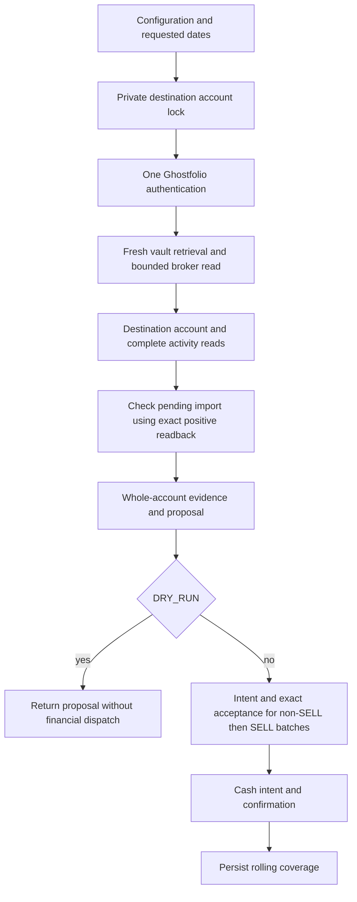

# Architecture

This describes the current implementation. [ADR-0002](adr/0002-durable-account-execution.md)
records an accepted deepening direction that has not yet changed the implementation.
[GLOSSARY.md](../GLOSSARY.md) defines the domain terms. README owns deployment and
configuration; the topical contracts below own financial and recovery behavior.

## Module responsibilities

The installed `ghostfolio_degiro_sync` package starts the staged extraction.
`config.py` validates the configuration boundary and constructs frozen settings
from `models.py`. The command uses an explicit dictionary conversion while its
execution functions remain in the legacy module. New package modules use strict
typing. Frozen data records carry settings and results; business operations
remain module-level functions. Credentials stay out of record representations.
The generated core remains outside this convention change.

| Module | Current location | Responsibility and seam |
| --- | --- | --- |
| Command orchestration | `ghostfolio_degiro_sync/app.py` | Validate command inputs, acquire snapshots and select execution modes. |
| Broker reading | `degiro.py`, `vault.py` | Retrieve credentials in isolated CLI state and perform bounded broker reads. |
| Ghostfolio transport | `ghostfolio.py` | Authenticate, enforce origins and routes, index complete destination evidence and prove accepted subsets. |
| Selection and execution | `sync.py` | Select activities with an injected clock, prove holdings and dispatch under journal guards. |
| Accounting and ownership | `accounting.py`, `identity.py` | Convert source events, classify cash and parse legacy/versioned ownership. |
| Journal and recovery | `journal.py` | Lock account state, persist intents and confirm exact readback. |
| Diagnostics and notifications | `diagnostics.py`, `notify.py` | Compare exact evidence, render private reports and run the isolated notification worker. |

These are conceptual modules, mostly implemented as functions in the adapter.
Moving functions to files alone would not reduce their interface knowledge.

## Execution order

The normal rolling command follows this sequence:

The lock covers acquisition as well as dispatch on the command path. The
snapshot-based `synchronize_account` seam locks reconciliation and dispatch,
but its caller supplies already acquired evidence. Full-history DRY_RUN can
run without a journal; rolling and prospective DRY_RUN hold the account lock.

Authentication POSTs are allowed in DRY_RUN. The financial transport blocks
imports and cash updates. Rolling DRY_RUN can verify positive import readback
but preserves a pending intent and does not advance coverage. Before financial
dispatch, relevant unknown or ambiguous evidence blocks the entire account.

## Journal ownership and outcomes

The lock is keyed by Ghostfolio origin and destination account, so a second
source configured for that destination cannot independently acquire ownership.
The journal also binds the source account and rejects an ownership mismatch.
Private state permissions, bounded size and atomic file replacement with file
and directory synchronization belong to the persistence implementation.

| Observation | Current behavior |
| --- | --- |
| Ready account, supported proposal | Persist an import intent before dispatch; accept only exact complete returned evidence. |
| Confirmed non-SELL batch | Update accepted holdings before evaluating the SELL batch. |
| Lost, partial, malformed or changed import outcome | Retain the pending intent and fence further writes and current-cash dispatch. |
| Complete exact positive import readback | Rolling live execution can confirm that import; DRY_RUN preserves it. Explicit recovery selects the request and has a separate local-confirmation option. |
| Absent or partial import readback | Retain uncertainty; no automatic replay or inference of cancellation. |
| Uncertain cash outcome, even if current balance matches | Retain the cash intent; positive import recovery does not apply. |
| Confirmed imports and cash, rolling live execution | Persist rolling coverage after completion. |
| Filesystem failure during persistence | Propagate failure; replacement may already be visible, so do not infer rollback or durability from an exception. |

The journal helpers currently expose a mutable document. Synchronization knows
when to prepare and confirm intents and directly publishes coverage. This is
the interface knowledge ADR-0002 proposes to concentrate; it is not evidence
that the safeguards are absent.

## Mode-specific evidence

| Mode | Evidence and permitted claim |
| --- | --- |
| Full history | Supported historical conversion; live writes require an explicit verified-completeness assertion. Reading many windows does not establish completeness. |
| Rolling | At least 90 days through broker-local today, bounded catch-up against recorded coverage, source statement and holdings proof, destination ownership and manual matching. No claim of complete history or cost basis. |
| Prospective | Proved opening evidence, protected prior destination history, full replay since cutover, source interval and resulting holdings proof. No relabeling of the result as full-history verification. |

Read [source-contract.md](source-contract.md),
[prospective-sync.md](prospective-sync.md), [fee-contract.md](fee-contract.md)
and [interest-compensation-policy.md](interest-compensation-policy.md) before
changing these rules. [Recovery](recovery.md) owns interrupted-request handling;
[authentication](ghostfolio-auth.md) owns credentials and origin policy.
[CORE_PROVENANCE.md](../CORE_PROVENANCE.md) owns projection and propagation.

## Test surface

The existing account-execution interface takes synthetic snapshots and explicit
import/cash callbacks; the real immutable-core writers and synthetic callbacks
are actual adapters at this seam. Recovery has its own selected-request
interface. Real temporary private files exercise persistence and restart
behavior without a second storage adapter.

Keep command-path tests as well: they cover configuration, acquisition date
scope, lock lifetime, one authentication and DRY_RUN transport policy that
snapshot-based tests cannot prove. Existing synchronization, rolling,
prospective, authentication and recovery regressions provide prior art.
Observe proposals, accepted evidence, dispatch order, durable state and
subsequent behavior; avoid asserting an internal helper call graph.

Broker/vault retrieval and bounded transports already hide substantial
implementation behind small interfaces. Their file size alone is not a
reason to add another seam. The core transport binding is sequential and
must not be interpreted as support for concurrent account execution in threads.
